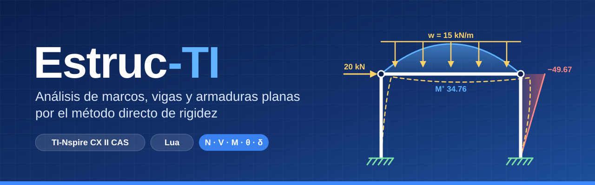
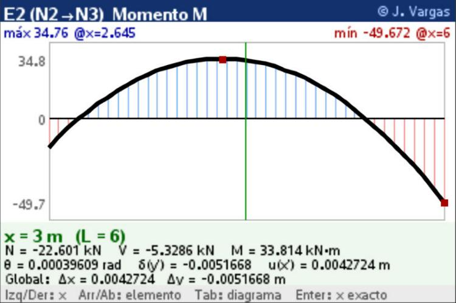
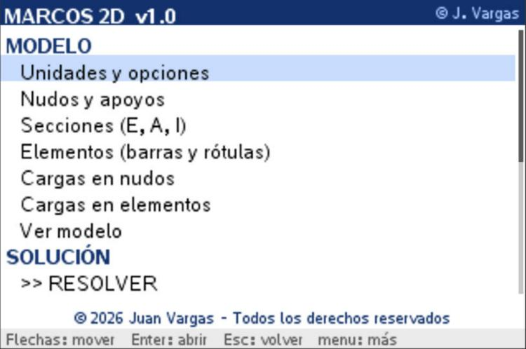
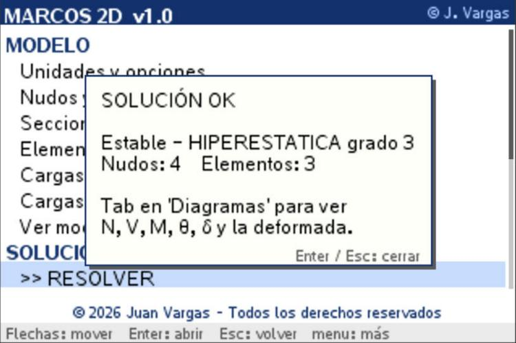
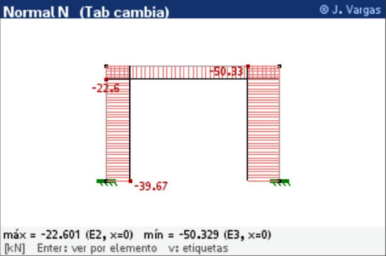
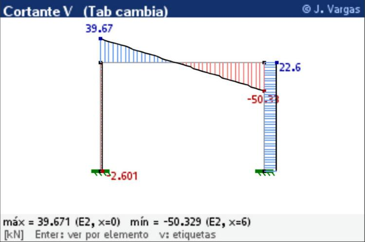
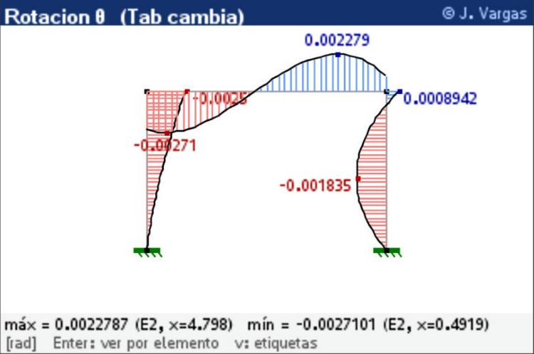
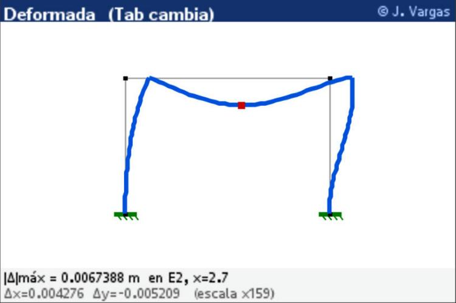
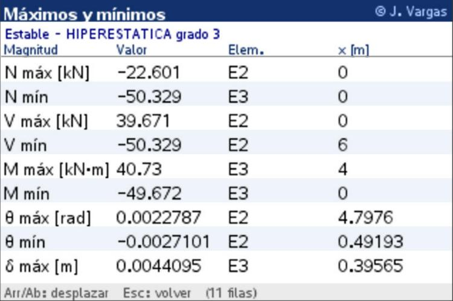

<p align="center">
  
</p>

<p align="center">
  
  
  
  <a href="https://github.com/juanvah14-civ/Estruc-TI/actions/workflows/pruebas.yml"></a>
</p>

<p align="center">
  <b>Resuelve vigas, marcos y armaduras 2D directamente en tu calculadora</b><br>
  Reacciones · desplazamientos · diagramas N, V, M, θ, δ · deformada · ecuaciones por tramo
</p>

<p align="center">
  <a href="#-instalación">Instalación</a> •
  <a href="#-uso-rápido">Uso rápido</a> •
  <a href="#-capturas">Capturas</a> •
  <a href="#-convención-de-signos">Signos</a> •
  <a href="#-validación">Validación</a> •
  <a href="docs/Guia_MARCOS2D.pdf"><b>📘 Manual de usuario (PDF)</b></a>
</p>

---

<table>
  <tr>
    <td width="50%"></td>
    <td width="50%"></td>
  </tr>
  <tr>
    <td align="center"><sub>Diagrama de momento sobre la estructura, con máximos y mínimos</sub></td>
    <td align="center"><sub>Vista por elemento: N, V, M, θ, δ, u en cualquier <i>x</i></sub></td>
  </tr>
</table>

## ✨ ¿Qué es Estruc-TI?

**Estruc-TI** (antes *MARCOS 2D*) es una aplicación en Lua para la **TI-Nspire CX II / CX II CAS** que analiza
estructuras planas formadas por barras con el **método directo de rigidez** (3 GDL por nudo). Funciona para
estructuras **isostáticas e hiperestáticas** de cualquier grado y fue pensada como herramienta para
**verificar ejercicios** de Mecánica de Sólidos y Análisis Estructural sin necesidad de una computadora.

## 🧰 Qué puede hacer

| | Función | Detalle |
|:-:|---|---|
| 🏗️ | **Estructuras** | Vigas simples, continuas y Gerber; marcos (pórticos) rectos e inclinados; armaduras |
| 📌 | **Apoyos** | Libre, empotrado, articulado, rodillos en X o Y, deslizaderas X o Y (sin giro) |
| 🔩 | **Condiciones especiales** | Rótulas en cualquier extremo de barra, asentamientos (Δx, Δy, θ) y resortes (kx, ky, kθ) |
| ⬇️ | **Cargas** | En nudos (Fx, Fy, M); en barras: puntuales, momentos y distribuidas uniformes, triangulares o trapezoidales (totales o parciales) |
| 🧭 | **Direcciones** | X / Y global, perpendicular (y′), axial (x′) y global **proyectada** (nieve, techos inclinados) |
| 📏 | **Unidades** | Fuerza: kN, N, kgf, tf, lbf, kip · Longitud: m, cm, mm, ft, in — con conversión automática del modelo |
| 🧮 | **Clasificación** | Isostática, hiperestática de grado *n* o inestable (indica el nudo del mecanismo) |
| 📊 | **Resultados** | Reacciones con verificación ΣF, desplazamientos, fuerzas en extremos, tabla de máximos, diagramas N · V · M · θ · δ y deformada |
| 🎯 | **Punto de interés** | Cursor sobre cada elemento o una *x* exacta; en cargas puntuales muestra el salto `izq / der` |
| 📝 | **Ecuaciones por tramo** *(v1.1)* | Expresiones de los esfuerzos de cada elemento por tramos |

> [!TIP]
> En los campos numéricos se pueden escribir **expresiones** que evalúa la calculadora: `200E6`, `0.3*0.5^3/12`, `√(2)`.

## 📦 Instalación

### Opción A — pasar el `.tns` a la calculadora

1. Conecta la calculadora por USB y abre **TI-Nspire CX CAS Student Software** (o *TI-Nspire Computer Link*).
2. En el **Explorador de contenido**, arrastra el archivo `.tns` de la app a la calculadora.
3. En la calculadora: **[home] → Mis documentos** y abre la app.

### Opción B — crear el `.tns` desde el código

1. En el Student Software: **Archivo → Nuevo documento**.
2. **Insertar → Editor de scripts → Insertar script…**, título `MarcosJV`.
3. Borra el texto de ejemplo, pega **todo** el contenido de [`src/MarcosJV.lua`](src/MarcosJV.lua) y presiona **Establecer script**.
4. Cierra el editor y guarda el documento como `.tns`.

> [!NOTE]
> El modelo se guarda **dentro del documento**. Si guardas el `.tns` en la calculadora (`ctrl`+`S`), la próxima vez
> lo encontrarás tal como lo dejaste. Puedes tener una copia por ejercicio (`Tarea3_Marco.tns`, …).

## 🚀 Uso rápido

```text
Inicio → Unidades → Nudos y apoyos → Secciones → Elementos → Cargas → RESOLVER → Resultados
```

1. **Unidades y opciones**: elige fuerza y longitud (por ejemplo kN y m).
2. **Nudos y apoyos**: coordenadas x, y y tipo de apoyo de cada nudo.
3. **Secciones**: E, A e I (varias barras pueden compartir sección).
4. **Elementos**: nudo i → nudo j, sección y rótulas.
5. **Cargas** en nudos y en elementos.
6. **>> RESOLVER** y recorre los diagramas con `tab`.

¿Quieres probar sin escribir nada? **Inicio → Ejemplos** trae cinco modelos listos.

### ⌨️ Teclas

| Tecla | Acción | Tecla | Acción |
|:-:|---|:-:|---|
| `▲▼◄►` | Moverse, desplazar el dibujo, mover el cursor | `+` / `−` | Agregar registro · acercar / alejar |
| `enter` | Abrir, editar o **guardar** formulario | `del` | Borrar registro (pide confirmación) |
| `esc` | Volver o cancelar | `0` | Ajustar el dibujo a la pantalla |
| `tab` | Siguiente diagrama o campo | `v` | Etiquetas: ninguna → máx./mín. → extremos |
| `menu` | Archivo, Modelo, Resultados | `n` | Mostrar / ocultar numeración |

## 📸 Capturas

<table>
  <tr>
    <td></td>
    <td></td>
    <td></td>
  </tr>
  <tr>
    <td align="center"><sub>Menú principal</sub></td>
    <td align="center"><sub>Modelo dibujado</sub></td>
    <td align="center"><sub>Clasificación al resolver</sub></td>
  </tr>
  <tr>
    <td></td>
    <td></td>
    <td></td>
  </tr>
  <tr>
    <td align="center"><sub>Reacciones</sub></td>
    <td align="center"><sub>Fuerza normal N</sub></td>
    <td align="center"><sub>Cortante V</sub></td>
  </tr>
  <tr>
    <td></td>
    <td></td>
    <td></td>
  </tr>
  <tr>
    <td align="center"><sub>Rotación θ</sub></td>
    <td align="center"><sub>Deflexión δ</sub></td>
    <td align="center"><sub>Deformada</sub></td>
  </tr>
</table>

<details>
<summary><b>Ver más: formularios, tablas y viga Gerber</b></summary>
<br>
<table>
  <tr>
    <td></td>
    <td></td>
    <td></td>
  </tr>
  <tr>
    <td align="center"><sub>Formulario de nudo</sub></td>
    <td align="center"><sub>Formulario de carga</sub></td>
    <td align="center"><sub>Ejemplos incluidos</sub></td>
  </tr>
  <tr>
    <td></td>
    <td></td>
    <td></td>
  </tr>
  <tr>
    <td align="center"><sub>Tabla de reacciones</sub></td>
    <td align="center"><sub>Máximos y mínimos</sub></td>
    <td align="center"><sub>Viga Gerber: momento</sub></td>
  </tr>
</table>
</details>

## ➕ Convención de signos

| Entrada (ejes globales) | Resultados (eje local x′ de i → j) |
|---|---|
| **+X** derecha · **+Y** arriba · momento **antihorario (+)** | **N (+)** = tracción |
| Izquierda, abajo y horario son **negativos** | **V (+)**: suma de fuerzas en +y′ a la izquierda del corte |
| | **M (+)** comprime la fibra +y′ — en una viga i → j hacia la derecha, M⁺ es la "sonrisa" · `dM/dx = V` |
| | **θ, δ** en ejes locales; **deformada, Δx, Δy** en ejes globales |

> [!IMPORTANT]
> Define las columnas **de abajo hacia arriba** y las vigas **de izquierda a derecha**: así los signos coinciden con la convención usual de los cursos.

## 🧪 Ejemplos incluidos

| # | Ejemplo | Resultado esperado |
|:-:|---|---|
| 1 | Viga simple, L = 6 m, w = −10 kN/m | Ry = 30 kN y 30 kN · Mmáx = 45 kN·m en x = 3 · δmáx = −0.0084375 m |
| 2 | Marco empotrado 6×4 m, 20 kN lateral + 15 kN/m | Hiperestático grado 3 · Rx1 = 2.6006 · Ry1 = 39.671 · M1 = 7.2981 · M4 = 40.730 |
| 3 | Viga continua de 2 tramos | Hiperestática grado 1 |
| 4 | Viga Gerber (empotrada + rótula + rodillo) | Isostática · Ry1 = 50 kN · M1 = 120 kN·m · R3 = 10 kN |
| 5 | Marco a dos aguas biarticulado | Hiperestático grado 1 · carga proyectada en el techo y viento en la columna |

## ✅ Validación

- Los esfuerzos N, V, M, θ y δ se integran **en forma exacta** en cada barra (no por subdivisión); los máximos interiores se refinan numéricamente.
- **71 comprobaciones automáticas** contra soluciones analíticas: viga simple, biempotrada, apoyada-empotrada, Gerber, armadura, asentamientos, resortes, carga triangular, barra inclinada, carga parcial, momento aplicado y conversión de unidades.
- El marco del ejemplo 2 se compara además contra un **solver independiente** escrito en Python.

Para correr las pruebas en PC (Lua 5.1 vía [`lupa`](https://pypi.org/project/lupa/), con la API de la Nspire simulada):

```bash
pip install lupa
python tests/run_tests.py
```

## ⚠️ Alcance y limitaciones

- Análisis **elástico lineal de primer orden**, 2D estático, barras prismáticas (E, A, I constantes por barra).
- No incluye cargas de temperatura, apoyos inclinados ni secciones variables.
- Recomendado hasta ~30 nudos; con más funciona, pero el cálculo y el dibujo se vuelven lentos.

> [!WARNING]
> **Uso responsable:** Estruc-TI es una herramienta de **verificación**. Resuelve los ejercicios a mano y usa la app para
> comprobar. Antes de usarla en una evaluación, confirma que tu docente lo permite.

## 🗂️ Estructura del repositorio

```text
Estruc-TI/
├── src/
│   └── MarcosJV.lua          # Programa completo (script Lua para la calculadora)
├── docs/
│   ├── Guia_MARCOS2D.pdf     # Manual de usuario completo
│   └── img/                  # Banner y capturas de pantalla
├── tests/
│   ├── test_marcos.lua       # Pruebas del motor e interfaz con mocks de la API Nspire
│   └── run_tests.py          # Ejecutor + comparación con solver independiente
├── CHANGELOG.md
└── LICENSE
```

## 🙏 Reconocimiento

La idea y la base de este programa provienen de la aplicación web **FEES** (`fees-ucr.vercel.app`), desarrollada por el
**Ing. Sergio Lobo Aguilar**, docente de la **Universidad de Costa Rica**. Estruc-TI toma como referencia su enfoque,
funciones y forma de presentar resultados, y los adapta a la TI-Nspire CX II CAS. Todo el crédito de la idea original
le corresponde.

## 👤 Autor

**Juan Vargas** — Estudiante de Ingeniería Civil · [@juanvah14-civ](https://github.com/juanvah14-civ)

Desarrollado con ayuda de la IA **Claude** (Anthropic).

<p align="center"><sub>© 2026 Juan Vargas · Todos los derechos reservados · Ver <a href="LICENSE">LICENSE</a></sub></p>
