<p align="center">
  
</p>

<p align="center">
  
  
  
  <a href="https://github.com/juanvah14-civ/Estruc-TI/releases/latest"></a>
  <a href="https://github.com/juanvah14-civ/Estruc-TI/actions/workflows/pruebas.yml"></a>
</p>

<p align="center">
  <b>Resuelve vigas, marcos y armaduras 2D directamente en tu calculadora</b><br>
  Editor gráfico · reacciones · desplazamientos · diagramas N, V, M, θ, δ · deformada · ecuaciones por tramo · cargas incógnitas (P, w…)
</p>

<p align="center">
  <a href="https://github.com/juanvah14-civ/Estruc-TI/releases/latest/download/Estruc-TI.tns"></a>
</p>

<p align="center">
  <a href="#-instalación">Instalación</a> •
  <a href="#-uso-rápido">Uso rápido</a> •
  <a href="#-capturas">Capturas</a> •
  <a href="#-convención-de-signos">Signos</a> •
  <a href="#-validación">Validación</a> •
  <a href="docs/Guia_MARCOS2D.pdf"><b>📘 Manual de usuario (PDF)</b></a>
</p>

---

<table>
  <tr>
    <td width="50%">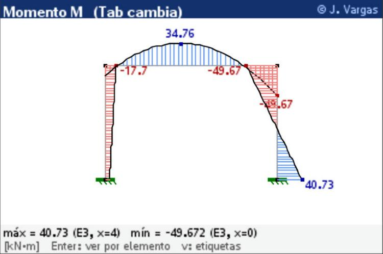</td>
    <td width="50%"></td>
  </tr>
  <tr>
    <td align="center"><sub>Diagrama de momento sobre la estructura, con máximos y mínimos</sub></td>
    <td align="center"><sub>Vista por elemento: N, V, M, θ, δ, u en cualquier <i>x</i></sub></td>
  </tr>
</table>

## ✨ ¿Qué es Estruc-TI?

**Estruc-TI** (antes *MARCOS 2D*) es una aplicación en Lua para la **TI-Nspire CX II / CX II CAS** que analiza
estructuras planas formadas por barras con el **método directo de rigidez** (3 GDL por nudo). Funciona para
estructuras **isostáticas e hiperestáticas** de cualquier grado y fue pensada como herramienta para
**verificar ejercicios** de Mecánica de Sólidos y Análisis Estructural sin necesidad de una computadora.

## 🆕 Novedades de la versión 1.3 — editor gráfico

- **Dibuja la estructura** con un cursor sobre una malla: crea nudos, cambia apoyos, une nudos con barras (marco o
  armadura) y coloca cargas viendo el modelo en todo momento (*Modelo → Editor gráfico*).
- Las listas de nudos, elementos y cargas muestran una **vista previa** con el registro seleccionado resaltado.
- **Diagramas y tablas más legibles**: los valores ya no se enciman y las columnas se ajustan a su contenido.

<table>
  <tr>
    <td>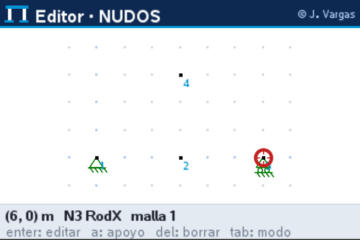</td>
    <td>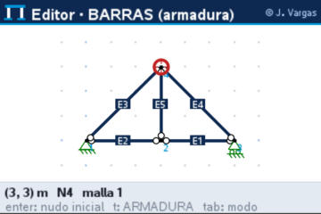</td>
  </tr>
  <tr>
    <td align="center"><sub>Editor gráfico: nudos sobre la malla y apoyos</sub></td>
    <td align="center"><sub>Editor gráfico: barras de armadura</sub></td>
  </tr>
  <tr>
    <td>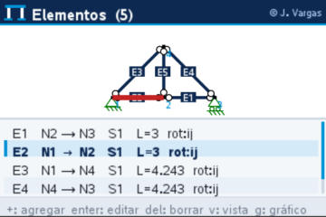</td>
    <td>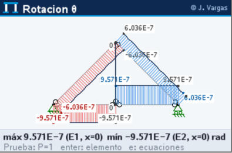</td>
  </tr>
  <tr>
    <td align="center"><sub>Lista con vista previa del elemento seleccionado</sub></td>
    <td align="center"><sub>Etiquetas sin encimarse</sub></td>
  </tr>
</table>

### Novedades de la versión 1.2 — cargas incógnitas

- Escribe **letras en el valor de una carga**: `P`, `-2P`, `P/2`, `w`, `3+0.5w`, `2(P+1)`… (una o varias incógnitas).
- Reacciones, desplazamientos, fuerzas en extremos y **ecuaciones por tramo** salen **en función de las incógnitas**,
  por ejemplo `Ry1 = 30 + 0.66667P` o `M(x) = (30 + 0.66667P)x − 5x²`.
- **Despejar incógnita**: ¿qué `P` hace que Ry1 = 40 kN, que la flecha en un punto sea −10 mm o que M(x) = 0? La app
  lo calcula directamente.
- Diagramas, deformada y máximos usan un **valor de prueba** de cada incógnita (por defecto 1), editable.
- La app ahora se llama **Estruc-TI** también dentro de la calculadora.

Ver el [historial completo de cambios](CHANGELOG.md).

## 🧰 Qué puede hacer

| | Función | Detalle |
|:-:|---|---|
| 🏗️ | **Estructuras** | Vigas simples, continuas y Gerber; marcos (pórticos) rectos e inclinados; armaduras |
| 📌 | **Apoyos** | Libre, empotrado, articulado, rodillos en X o Y, deslizaderas X o Y (sin giro) |
| 🔩 | **Condiciones especiales** | Rótulas en cualquier extremo de barra, asentamientos (Δx, Δy, θ) y resortes (kx, ky, kθ) |
| ⬇️ | **Cargas** | En nudos (Fx, Fy, M); en barras: puntuales, momentos y distribuidas uniformes, triangulares o trapezoidales (totales o parciales) |
| 🧭 | **Direcciones** | X / Y global, perpendicular (y′), axial (x′) y global **proyectada** (nieve, techos inclinados) |
| 📏 | **Unidades** | Fuerza: kN, N, kgf, tf, lbf, kip · Longitud: m, cm, mm, ft, in — con conversión automática del modelo |
| 🧮 | **Clasificación** | Isostática, hiperestática de grado *n* o inestable (indica el nudo del mecanismo) |
| 📊 | **Resultados** | Reacciones con verificación ΣF, desplazamientos, fuerzas en extremos, tabla de máximos, diagramas N · V · M · θ · δ y deformada |
| 🎯 | **Punto de interés** | Cursor sobre cada elemento o una *x* exacta; en cargas puntuales muestra el salto `izq / der` |
| 📝 | **Ecuaciones por tramo** *(v1.1)* | Expresiones de los esfuerzos de cada elemento por tramos |
| ✏️ | **Editor gráfico** *(v1.3)* | Nudos, barras y cargas con un cursor sobre una malla; vista previa en las listas |
| 🔣 | **Cargas incógnitas** *(v1.2)* | Cargas como `P`, `-2P`, `w`; resultados en función de ellas y despeje de la incógnita para una condición dada |

> [!TIP]
> En los campos numéricos se pueden escribir **expresiones** que evalúa la calculadora: `200E6`, `0.3*0.5^3/12`, `√(2)`.

## 📦 Instalación

### Opción A — pasar el `.tns` a la calculadora

1. Descarga [**`Estruc-TI.tns`**](https://github.com/juanvah14-civ/Estruc-TI/releases/latest/download/Estruc-TI.tns) desde la [última versión](https://github.com/juanvah14-civ/Estruc-TI/releases/latest).
2. Conecta la calculadora por USB y abre **TI-Nspire CX CAS Student Software** (o *TI-Nspire Computer Link*).
3. En el **Explorador de contenido**, arrastra `Estruc-TI.tns` a la calculadora.
4. En la calculadora: **[home] → Mis documentos** → `Estruc-TI`.

### Opción B — crear el `.tns` desde el código

1. En el Student Software: **Archivo → Nuevo documento**.
2. **Insertar → Editor de scripts → Insertar script…**, título `MarcosJV`.
3. Borra el texto de ejemplo, pega **todo** el contenido de [`src/MarcosJV.lua`](src/MarcosJV.lua) y presiona **Establecer script**.
4. Cierra el editor y guarda el documento como `.tns`.

> [!NOTE]
> El modelo se guarda **dentro del documento**. Si guardas el `.tns` en la calculadora (`ctrl`+`S`), la próxima vez
> lo encontrarás tal como lo dejaste. Puedes tener una copia por ejercicio (`Tarea3_Marco.tns`, …).

## 🚀 Uso rápido

```text
Inicio → Unidades → Nudos y apoyos → Secciones → Elementos → Cargas → RESOLVER → Resultados
```

1. **Unidades y opciones**: elige fuerza y longitud (por ejemplo kN y m).
2. **Nudos y apoyos**: coordenadas x, y y tipo de apoyo de cada nudo.
3. **Secciones**: E, A e I (varias barras pueden compartir sección).
4. **Elementos**: nudo i → nudo j, sección y rótulas.
5. **Cargas** en nudos y en elementos.
6. **>> RESOLVER** y recorre los diagramas con `tab`.

¿Quieres probar sin escribir nada? **Inicio → Ejemplos** trae siete modelos listos.

### ⌨️ Teclas

| Tecla | Acción | Tecla | Acción |
|:-:|---|:-:|---|
| `▲▼◄►` | Moverse, desplazar el dibujo, mover el cursor | `+` / `−` | Agregar registro · acercar / alejar |
| `enter` | Abrir · en formularios pasa al siguiente campo (al final, **GUARDAR**) | `del` | Borrar registro (pide confirmación) |
| `esc` | Volver o cancelar | `0` | Ajustar el dibujo a la pantalla |
| `tab` | Siguiente diagrama o campo | `v` | Etiquetas: ninguna → máx./mín. → extremos |
| `menu` | Archivo, Modelo, Resultados | `n` | Mostrar / ocultar numeración |
| `e` | Ecuaciones por tramo (desde diagramas) | `s` | Valores en función de las incógnitas (vista por elemento) |

### ✏️ Editor gráfico

*Modelo → Editor gráfico* (o `enter` en *Ver modelo*). Las flechas mueven el cursor sobre la malla y `tab` cambia de modo:

| Modo | `enter` | Otras teclas |
|---|---|---|
| **Nudos** | Crea un nudo en el cursor o edita el que está debajo | `a` cambia el apoyo · `del` borra · `g` paso de la malla |
| **Barras** | En un nudo inicia la barra; en otro nudo la termina (se puede seguir encadenando) | `t` marco / armadura · `esc` termina la cadena · `del` borra la barra |
| **Cargas** | Sobre un nudo: carga en el nudo · sobre una barra: carga puntual en ese punto | `del` borra las cargas de ese nudo o barra |

Las barras se orientan solas (vigas de izquierda a derecha, columnas de abajo hacia arriba) para que los signos sigan la
convención del curso. En las listas, `v` muestra u oculta la vista previa y `g` abre el editor.

### 🔣 Cargas incógnitas (P, w…)

1. En **Cargas en nudos** o **Cargas en elementos**, escribe la incógnita en el valor: `-P` (P hacia abajo), `2P`,
   `w`, `P/2`, `10+P`… Solo se aceptan expresiones **lineales** (no `P*P` ni `1/P`).
2. **RESOLVER**: las reacciones aparecen como `30 + 0.66667P`. También las tablas, las **ecuaciones por tramo** y la
   vista por elemento (tecla `s`).
3. **Modelo → Incógnitas** cambia el valor de prueba con que se dibujan los diagramas y se buscan los máximos.
4. **Solución → Despejar incógnita**: elige la magnitud (reacción, desplazamiento de nudo o N, V, M, θ, δ en un punto),
   el valor deseado y la incógnita. Con `enter` puedes usar el resultado como nuevo valor de prueba.

> [!NOTE]
> La estructura es lineal, así que los resultados se obtienen **por superposición exacta** (un cálculo con las
> incógnitas en cero y uno por cada incógnita). La posición de los máximos sí depende del valor de las incógnitas,
> por eso los diagramas usan los valores de prueba.

<table>
  <tr>
    <td>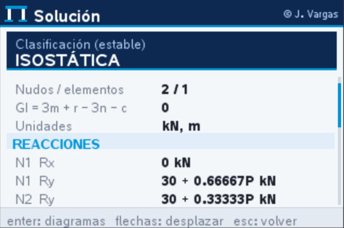</td>
    <td>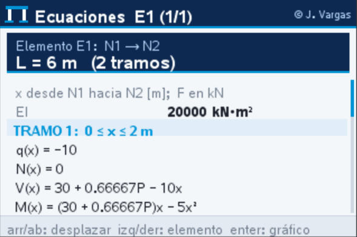</td>
  </tr>
  <tr>
    <td align="center"><sub>Reacciones en función de P</sub></td>
    <td align="center"><sub>Ecuaciones por tramo con P</sub></td>
  </tr>
  <tr>
    <td>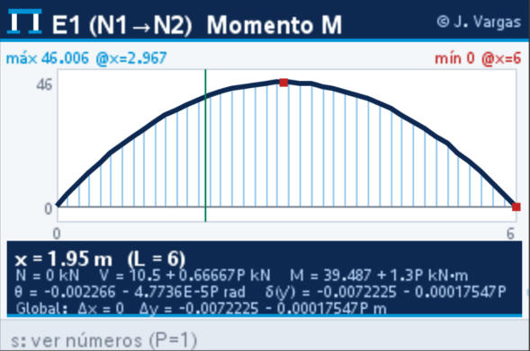</td>
    <td>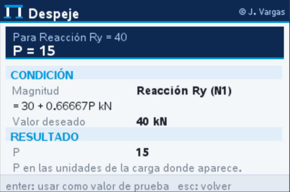</td>
  </tr>
  <tr>
    <td align="center"><sub>Punto de interés en función de P (tecla s)</sub></td>
    <td align="center"><sub>Despejar P para que Ry1 = 40 kN</sub></td>
  </tr>
</table>

## 📸 Capturas

<table>
  <tr>
    <td></td>
    <td>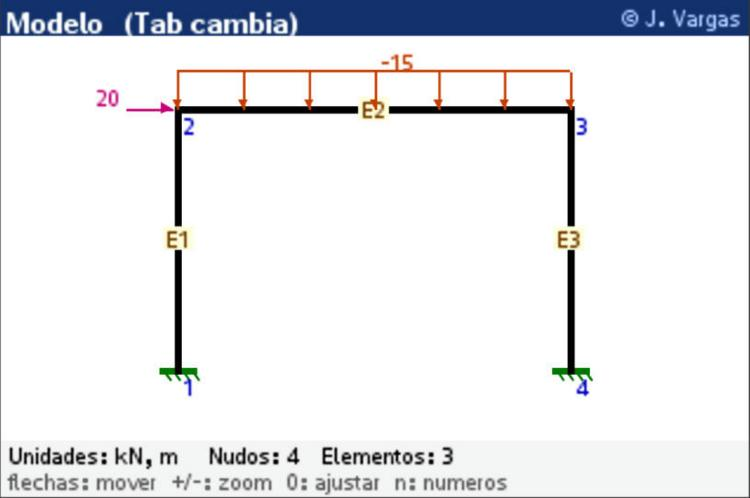</td>
    <td></td>
  </tr>
  <tr>
    <td align="center"><sub>Menú principal</sub></td>
    <td align="center"><sub>Modelo dibujado</sub></td>
    <td align="center"><sub>Clasificación al resolver</sub></td>
  </tr>
  <tr>
    <td>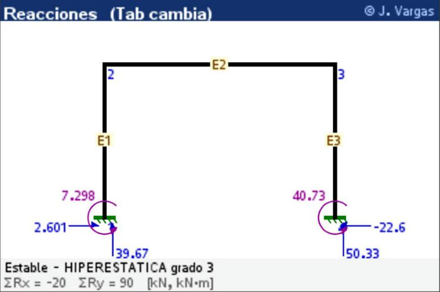</td>
    <td></td>
    <td></td>
  </tr>
  <tr>
    <td align="center"><sub>Reacciones</sub></td>
    <td align="center"><sub>Fuerza normal N</sub></td>
    <td align="center"><sub>Cortante V</sub></td>
  </tr>
  <tr>
    <td></td>
    <td>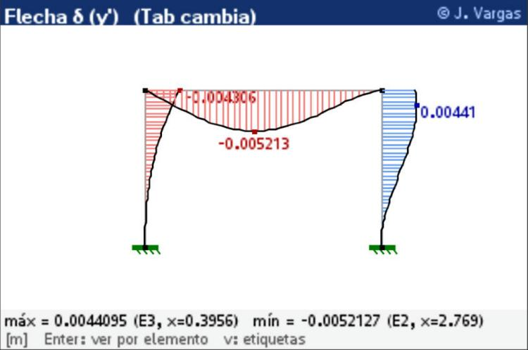</td>
    <td></td>
  </tr>
  <tr>
    <td align="center"><sub>Rotación θ</sub></td>
    <td align="center"><sub>Deflexión δ</sub></td>
    <td align="center"><sub>Deformada</sub></td>
  </tr>
</table>

<details>
<summary><b>Ver más: formularios, tablas y viga Gerber</b></summary>
<br>
<table>
  <tr>
    <td>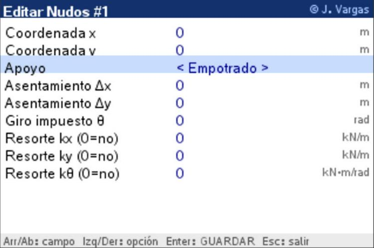</td>
    <td>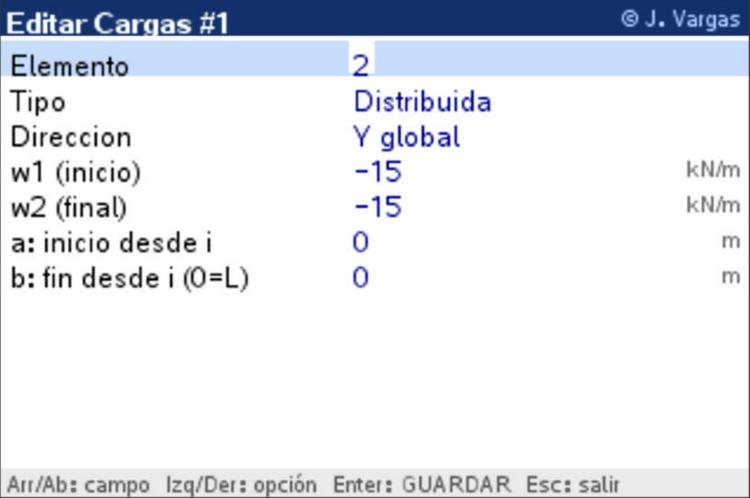</td>
    <td>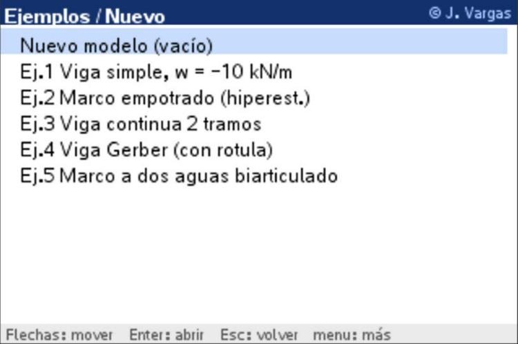</td>
  </tr>
  <tr>
    <td align="center"><sub>Formulario de nudo</sub></td>
    <td align="center"><sub>Formulario de carga</sub></td>
    <td align="center"><sub>Ejemplos incluidos</sub></td>
  </tr>
  <tr>
    <td>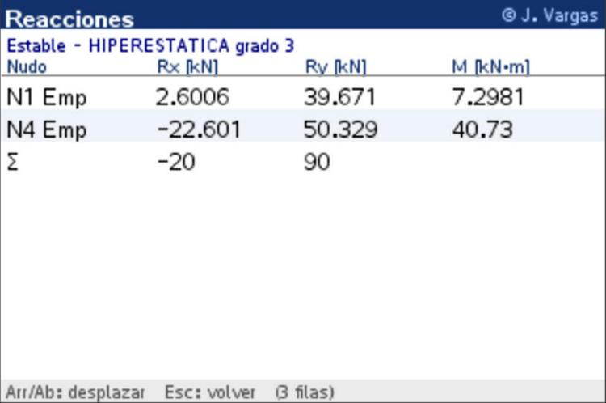</td>
    <td></td>
    <td>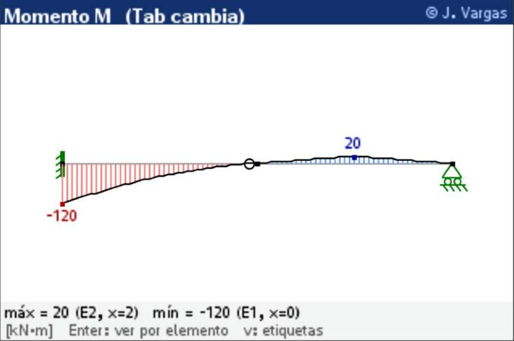</td>
  </tr>
  <tr>
    <td align="center"><sub>Tabla de reacciones</sub></td>
    <td align="center"><sub>Máximos y mínimos</sub></td>
    <td align="center"><sub>Viga Gerber: momento</sub></td>
  </tr>
</table>
</details>

## ➕ Convención de signos

| Entrada (ejes globales) | Resultados (eje local x′ de i → j) |
|---|---|
| **+X** derecha · **+Y** arriba · momento **antihorario (+)** | **N (+)** = tracción |
| Izquierda, abajo y horario son **negativos** | **V (+)**: suma de fuerzas en +y′ a la izquierda del corte |
| | **M (+)** comprime la fibra +y′ — en una viga i → j hacia la derecha, M⁺ es la "sonrisa" · `dM/dx = V` |
| | **θ, δ** en ejes locales; **deformada, Δx, Δy** en ejes globales |

> [!IMPORTANT]
> Define las columnas **de abajo hacia arriba** y las vigas **de izquierda a derecha**: así los signos coinciden con la convención usual de los cursos.

## 🧪 Ejemplos incluidos

| # | Ejemplo | Resultado esperado |
|:-:|---|---|
| 1 | Viga simple, L = 6 m, w = −10 kN/m | Ry = 30 kN y 30 kN · Mmáx = 45 kN·m en x = 3 · δmáx = −0.0084375 m |
| 2 | Marco empotrado 6×4 m, 20 kN lateral + 15 kN/m | Hiperestático grado 3 · Rx1 = 2.6006 · Ry1 = 39.671 · M1 = 7.2981 · M4 = 40.730 |
| 3 | Viga continua de 2 tramos | Hiperestática grado 1 |
| 4 | Viga Gerber (empotrada + rótula + rodillo) | Isostática · Ry1 = 50 kN · M1 = 120 kN·m · R3 = 10 kN |
| 5 | Marco a dos aguas biarticulado | Hiperestático grado 1 · carga proyectada en el techo y viento en la columna |
| 6 | *(en el menú: "Viga con carga P")* Viga simple L = 6 m, w = −10 kN/m y carga −P en x = 2 m | Ry1 = 30 + 0.66667P · Ry2 = 30 + 0.33333P · M(2) = 40 + 1.3333P · Ry1 = 40 kN ⇒ P = 15 kN |
| 7 | *(en el menú: "Armadura con carga P")* Armadura de 5 barras, 6 m de luz y 3 m de altura, carga −P en la cumbrera | Isostática · Ry = 0.5P en cada apoyo · diagonales −0.70711P · cordón inferior 0.5P |

## ✅ Validación

- Los esfuerzos N, V, M, θ y δ se integran **en forma exacta** en cada barra (no por subdivisión); los máximos interiores se refinan numéricamente.
- **132 comprobaciones automáticas** contra soluciones analíticas: viga simple, biempotrada, apoyada-empotrada, Gerber, armadura, asentamientos, resortes, carga triangular, barra inclinada, carga parcial, momento aplicado, conversión de unidades y, desde la v1.2, cargas incógnitas (superposición en vigas y marcos hiperestáticos, ecuaciones simbólicas y despeje).
- El marco del ejemplo 2 se compara además contra un **solver independiente** escrito en Python.

Para correr las pruebas en PC (Lua 5.1 vía [`lupa`](https://pypi.org/project/lupa/), con la API de la Nspire simulada):

```bash
pip install lupa
python tests/run_tests.py
```

## ⚠️ Alcance y limitaciones

- Análisis **elástico lineal de primer orden**, 2D estático, barras prismáticas (E, A, I constantes por barra).
- No incluye cargas de temperatura, apoyos inclinados ni secciones variables.
- Recomendado hasta ~30 nudos; con más funciona, pero el cálculo y el dibujo se vuelven lentos.

> [!WARNING]
> **Uso responsable:** Estruc-TI es una herramienta de **verificación**. Resuelve los ejercicios a mano y usa la app para
> comprobar. Antes de usarla en una evaluación, confirma que tu docente lo permite.

## 🗂️ Estructura del repositorio

```text
Estruc-TI/
├── src/
│   └── MarcosJV.lua          # Programa completo (script Lua para la calculadora)
├── docs/
│   ├── Guia_MARCOS2D.pdf     # Manual de usuario completo
│   └── img/                  # Banner y capturas de pantalla
├── tests/
│   ├── test_marcos.lua       # Pruebas del motor e interfaz con mocks de la API Nspire
│   └── run_tests.py          # Ejecutor + comparación con solver independiente
├── CHANGELOG.md
└── LICENSE
```

## 🙏 Reconocimiento

La idea y la base de este programa provienen de la aplicación web **FEES** (`fees-ucr.vercel.app`), desarrollada por el
**Ing. Sergio Lobo Aguilar**, docente de la **Universidad de Costa Rica**. Estruc-TI toma como referencia su enfoque,
funciones y forma de presentar resultados, y los adapta a la TI-Nspire CX II CAS. Todo el crédito de la idea original
le corresponde.

## 👤 Autor

**Juan Vargas** — Estudiante de Ingeniería Civil · [@juanvah14-civ](https://github.com/juanvah14-civ)

Desarrollado con ayuda de la IA **Claude** (Anthropic).

<p align="center"><sub>© 2026 Juan Vargas · Todos los derechos reservados · Ver <a href="LICENSE">LICENSE</a></sub></p>
